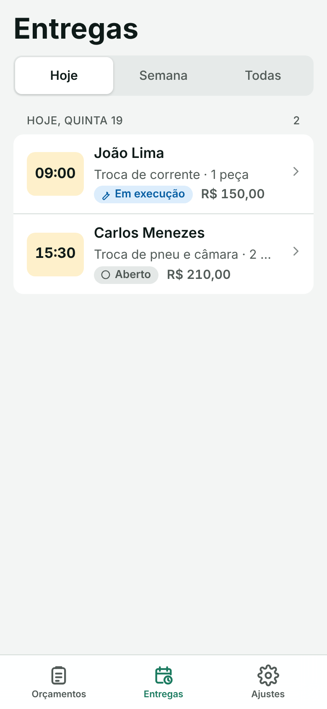
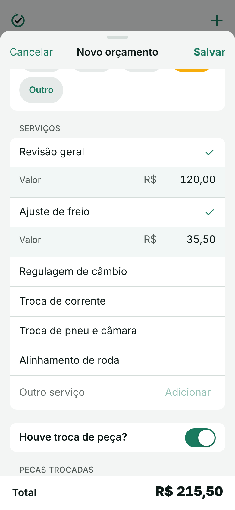
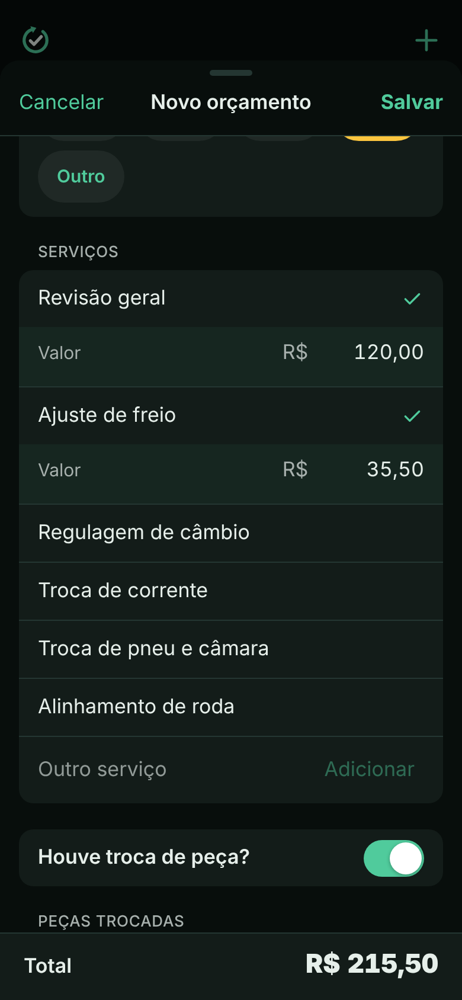

# Budgetcycle

PWA para registrar orçamentos de uma oficina de bicicleta, do balcão até a entrega. Feito para a **Bicicloed**, funciona instalado no celular e no computador.

[](https://github.com/Ebertdev/Budget-Cycle/actions/workflows/ci.yml)


<p align="center">
  
  
  
  
</p>

<details>
<summary>Ver no tema escuro</summary>

<p align="center">
  
  
  
  
</p>

Os dados das capturas de tela são fictícios.

</details>

## Sumário

- [Por que existe](#por-que-existe)
- [Funcionalidades](#funcionalidades)
- [Tecnologias e decisões](#tecnologias-e-decisões)
- [Como rodar](#como-rodar)
- [Testes e CI](#testes-e-ci)
- [API](#api)
- [Limitações e próximos passos](#limitações-e-próximos-passos)

## Por que existe

Na Bicicloed, os serviços e orçamentos ficavam espalhados em um caderno. Achar um orçamento antigo era demorado e isso gerava gargalos no balcão. O Budgetcycle centraliza esses dados em um só lugar: o atendente busca por nome ou telefone e vê o que foi combinado, quanto custa e quando entregar, sem folhear páginas.

## Funcionalidades

Cada orçamento guarda o cliente, o telefone (Brasil, +55), a data em que foi feito, o dia e o horário da entrega, os serviços, as peças trocadas (só quando há troca) e o valor de cada item.

**Orçamentos**
- Lista com busca por nome ou telefone.
- Detalhe com botões para ligar e abrir o WhatsApp.
- Preço em cada serviço e em cada peça (valor unitário × quantidade), com o total ao vivo no formulário, no detalhe e na lista.
- Data do orçamento gravada na criação, no fuso da loja, sem alteração na edição.

**Exportação**
- Baixar o orçamento em PDF, gerado no próprio aparelho.
- Compartilhar o PDF, onde o aparelho permite.
- Copiar como texto para colar no WhatsApp ou em um e-mail.

**Fluxo e entregas**
- Status: Aberto → Em execução → Pronto → Entregue, com Cancelar a qualquer momento. Entregue e Cancelado bloqueiam a edição.
- Entregas em Hoje, Semana e Todas, agrupadas por dia, a partir de hoje e só com o que ainda não foi entregue.
- Aviso, sem bloqueio, quando o horário de entrega já está ocupado.
- Atalhos de horário (09:00, 10:30, 14:00, 15:30) e "Outro" para qualquer horário.

**App**
- Instalável como PWA, com os últimos orçamentos consultados disponíveis offline.
- Tema automático, claro ou escuro, e horários de atalho configuráveis em Ajustes.

## Tecnologias e decisões

| Camada | Tecnologias |
| --- | --- |
| API | Java 21, Spring Boot 3.4, Spring Data JPA, Bean Validation, Flyway |
| Banco | PostgreSQL 16 |
| Front-end | React 19, TypeScript, Vite, vite-plugin-pwa, jsPDF |
| Testes | JUnit 5, MockMvc, H2 (modo PostgreSQL), Vitest |
| CI | GitHub Actions |

```
backend/    API REST (Spring Boot) e migrações Flyway
frontend/   PWA (React + TypeScript)
docs/       design, plano de implementação e capturas de tela
.github/    pipeline de CI
```

Decisões de projeto:
- **Dinheiro em centavos no front-end**, para não acumular erro de ponto flutuante, e `NUMERIC(10,2)` no banco.
- **Data do orçamento em coluna própria**, calculada com um `Clock` no fuso da loja, para não depender do fuso do servidor.
- **Status acessível:** sempre cor, ícone e texto juntos. O âmbar aparece só na entrega.
- **Tipografia:** fonte do sistema na interface e Barlow Condensed apenas no logo.

## Como rodar

Pré-requisitos: Java 21, Maven 3.9+, Node 20+ e Docker.

1. **Banco de dados**

   ```bash
   docker compose up -d
   ```

2. **API** (porta 8080; o Flyway cria e atualiza as tabelas na primeira execução)

   ```bash
   cd backend
   mvn spring-boot:run
   ```

3. **Front-end** (porta 5173; o Vite encaminha `/api` para a porta 8080)

   ```bash
   cd frontend
   npm install
   npm run dev
   ```

Abra http://localhost:5173. Para instalar como app, use o ícone "Instalar" do navegador (no celular, "Adicionar à tela inicial"). O service worker só é gerado no build: use `npm run build && npm run preview` para testar o PWA.

**Configuração da API**

| Variável | Padrão |
| --- | --- |
| `DB_URL` | `jdbc:postgresql://localhost:5432/orcamentos` |
| `DB_USER` / `DB_PASSWORD` | `orcamentos` / `orcamentos` |
| `CORS_ORIGIN` | `http://localhost:5173` |
| `APP_FUSO` | `America/Bahia` (define o dia gravado como "data do orçamento") |

No front-end, `VITE_API_URL` define a URL da API quando ela não está no mesmo domínio.

## Testes e CI

```bash
cd backend && mvn test      # API com MockMvc e H2 (modo PostgreSQL)
cd frontend && npm test     # validação, máscara de telefone, datas, entregas, valores e exportação
cd frontend && npm run build
```

O GitHub Actions (`.github/workflows/ci.yml`) roda os mesmos comandos a cada push e pull request.

## API

Base: `/api/v1/orcamentos`

| Método | Rota | Descrição |
| --- | --- | --- |
| `POST` | `/` | Cria um orçamento (201). A resposta traz `avisos` se o horário já estiver ocupado. |
| `GET` | `/` | Lista com paginação. Filtros: `busca`, `dataEntrega`, `entregaDe`, `entregaAte`, `pendentes`. Também `page`, `size` e `sort`. |
| `GET` | `/{id}` | Busca um orçamento. |
| `PUT` | `/{id}` | Atualiza (409 se estiver entregue ou cancelado). |
| `PATCH` | `/{id}/status` | Muda o status (409 se estiver entregue ou cancelado). |
| `DELETE` | `/{id}` | Exclui. |

Também há `GET /actuator/health`. Erros seguem o formato `{ status, erro, campos: [{ campo, mensagem }] }`.

<details>
<summary>Exemplo de criação</summary>

```json
{
  "nomeCliente": "Maria Souza",
  "telefone": "71999990000",
  "dataEntrega": "2026-11-22",
  "horarioEntrega": "15:30",
  "observacoes": "Revisão completa",
  "servicos": [{ "descricao": "Revisão geral", "valor": 120.00 }],
  "pecas": [{ "nomePeca": "Câmara de ar aro 29", "quantidade": 2, "valorUnitario": 30.00 }]
}
```

A resposta acrescenta `id`, `status`, `valorTotal`, o `subtotal` de cada peça, `dataOrcamento`, `criadoEm`, `atualizadoEm` e `avisos`.

</details>

## Limitações e próximos passos

Limitações conhecidas:
- Não há login: qualquer pessoa com acesso à API vê todos os orçamentos.
- Entregas atrasadas e ainda pendentes não aparecem em nenhuma aba de Entregas (todas começam em hoje); elas continuam na lista de Orçamentos.
- O status Aprovado existe na API, mas ainda não tem botão na interface.

Próximos passos:
- Regras de status e de total no domínio, com testes unitários.
- Separação leve entre consultas e comandos na camada de serviço.
- Login, catálogo de serviços e peças, forma de pagamento e desconto.
